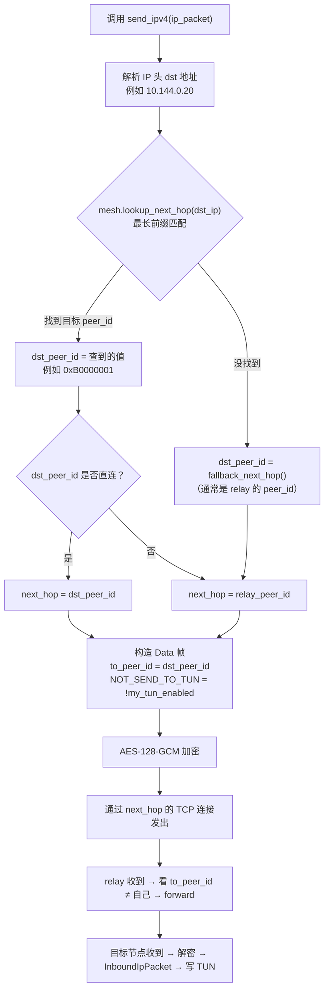
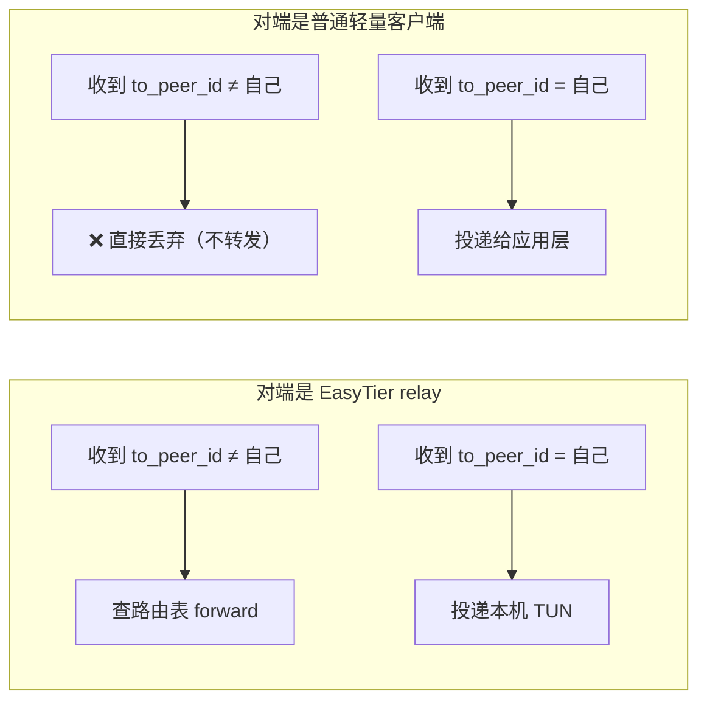

# mesh-tun-proto 接入指南

> 一个轻量、**无运行时依赖**的 EasyTier 协议兼容层：
> 下游 P2P / TUN 工具只要能给我一个 TCP/UDP 字节流，我就能把它接进 EasyTier mesh 网络，
> 完成握手、路由广播、IPv4 包转发、自定义 Data 帧收发 —— **不需要你再依赖 EasyTier Core 二进制**。

---

## 目录

- [1. 这个库是什么](#1-这个库是什么)
- [2. 前置条件](#2-前置条件)
- [3. 我能做什么 / 我不做什么](#3-我能做什么--我不做什么)
- [4. 最小化三步走（TUN 接入）](#4-最小化三步走tun-接入)
- [5. 不用 TUN？直接发用户自定义 Data 帧](#5-不用-tun直接发用户自定义-data-帧)
- [6. 路由决策原理](#6-路由决策原理)
- [7. API 索引](#7-api-索引)
- [8. 线程模型与并发](#8-线程模型与并发)
- [9. 错误处理与异常场景](#9-错误处理与异常场景)
- [10. 完整示例](#10-完整示例)
- [11. 调试工具](#11-调试工具)
- [12. FAQ](#12-faq)

---

## 1. 这个库是什么

`mesh-tun-proto` 是一个 **EasyTier 网络协议的轻量客户端实现**。

EasyTier 是一个去中心化的 mesh VPN 组网工具，官方提供了完整的 Core 节点（含 NAT 穿透、TUN 管理、路由协议等）。但很多下游 P2P 工具只需要：

- **接入 EasyTier 网络和其他节点通信**（收发 IP 包 / 自定义数据）
- **不想引入完整的 EasyTier Core 二进制**（太重、依赖太多、或自己已有 P2P 打洞逻辑）

本库就是为这个场景设计的：**只实现 EasyTier 协议层**（握手、加密、路由同步、Data 帧编解码），不做 NAT 穿透、不做 TUN 设备管理、不做服务端。你给我一个 TCP 字节流，我还你一个能和 EasyTier 网络互通的客户端。

---

## 2. 前置条件

在开始编码前，你需要准备以下内容：

### 2.1 一个已启动的 EasyTier relay 节点

本库**只实现客户端**，不实现 relay/服务端。你需要一个正在运行的 EasyTier Core 节点作为 relay：

- **自己部署**：从 [EasyTier 官方发布页](https://github.com/EasyTier/EasyTier/releases) 下载二进制，或自行编译
- **使用公共节点**：EasyTier 社区提供了一些公共 relay，但生产环境建议自建

启动 relay 示例（EasyTier Core）：

```bash
easytier-core \
    --network-name mynet \
    --network-secret mypass \
    --listeners tcp://0.0.0.0:11010 \
    --no-tun          # relay 不需要 TUN，只做转发
```

### 2.2 获取 network_name 和 network_secret

这两个值由 relay 管理员在启动 Core 时配置。**客户端必须和 relay 完全一致**，否则握手时身份验证失败（`network identity not match`）。

- `network_name`：网络名称，任意字符串（如 `"mynet"`）
- `network_secret`：网络密钥，任意字符串（如 `"mypass"`）

### 2.3 TUN 设备（仅 TUN 接入模式需要）

如果你要用 TUN 模式收发 IP 包，需要先在本机创建 TUN 设备：

```bash
# Linux
ip tuntap add tun0 mode tun
ip link set tun0 up
ip addr add 10.144.0.10/24 dev tun0

# macOS（需先安装 utun 工具或使用 tuntaposx）
# Windows（需 tap-windows 驱动）
```

如果只是用 `send_data_to()` 发自定义消息（非 IP 包），则不需要 TUN。

### 2.4 Rust 工具链

```bash
rustc 1.70+（edition 2021）
```

---

## 3. 我能做什么 / 我不做什么

### 做

| 类别 | 能力 |
|------|------|
| **安全** | 基于 `network_name + network_secret` 的身份验证（SipHash13 + AES-128-GCM 加密） |
| **路由** | OSPF 风格的 SyncRouteInfo RPC：自动学习全网节点路由表（peer_id ↔ hostname ↔ vip） |
| **数据通道（IP）** | Data 帧 `NOT_SEND_TO_TUN=0`：收发原始 IPv4/IPv6 包，直接对接 TUN 设备 |
| **数据通道（自定义）** | Data 帧 `NOT_SEND_TO_TUN=1`：收发任意字节串（聊天消息、控制信令），不经过 TUN |
| **保活** | 自动响应 Ping/Pong，维持与 relay 的 TCP 连接 |

### 不做

| 类别 | 说明 |
|------|------|
| **NAT 穿透** | 不实现打洞逻辑。下游工具把已打通的 socket 交给我们即可 |
| **TUN 设备管理** | 不创建/配置 TUN。只提供 `send_ipv4()` / `recv_ipv4()` 接口，由下游工具自己读写 TUN 文件 |
| **服务端** | 不实现 relay/服务端握手。只做客户端 |
| **Center 选举** | 不参与 EasyTier 的 center 节点选举 |

---

## 4. 最小化三步走（TUN 接入）

### 第 1 步：初始化 + 连接 EasyTier relay

```rust
use mesh_tun_proto::{P2pNode, P2pEvent};
use std::net::TcpStream;

let stream = TcpStream::connect("10.0.0.1:11010")?;

let mut node = P2pNode::new(
    "mynet",   // network_name（必须和 relay 一致）
    "mypass",  // network_secret（必须和 relay 一致）
    None,      // None = 随机生成 peer_id；Some(u32) = 手动指定
);

let my_peer_id = node.identity.my_peer_id;
let relay_peer_id = node.add_stream_conn(stream)?;
// relay_peer_id 是 relay 节点的 peer_id，后续路由会用
```

### 第 2 步：声明 TUN + 广播自己的虚拟 IP

```rust
// ★ 关键：告诉库"我挂了 TUN"，发 IP 包时会清掉 NOT_SEND_TO_TUN flag
node.set_my_tun_enabled(true);

let my_virtual_ip = u32::from_be_bytes([10, 144, 0, 10]);

// 广播给所有直连 peer（relay 会帮你在全网传播这条 /32 路由）
let sent = node.announce_self_to_all("my-hostname", Some(my_virtual_ip));
eprintln!("广播给 {sent} 个 peer");
```

### 第 3 步：主循环 —— TUN ↔ node 双向搬运

```rust
use std::time::{Duration, Instant};

let mut last_announce = Instant::now();

loop {
    // (a) TUN → node：读 TUN 的 IP 包，发给目标 peer
    if let Some(pkt) = try_read_from_tun() {   // 你的 TUN 读逻辑
        node.send_ipv4(&pkt).ok();
    }

    // (b) node → TUN：弹出收到的 IP 包，写进 TUN
    while let Some(pkt) = node.recv_ipv4() {
        write_into_tun(&pkt);                   // 你的 TUN 写逻辑
    }

    // (c) 处理事件（PeerUp / RouteChanged / DecryptError 等）
    for ev in node.tick(32) {
        match ev {
            P2pEvent::RouteChanged { peers, .. } => {
                eprintln!("路由刷新，全网 {peers} 个节点");
            }
            P2pEvent::PeerUp { peer_id, label } => {
                eprintln!("新节点: {peer_id:#x} via {label}");
            }
            _ => {}
        }
    }

    // (d) 每 10s 重发 announce（防止 relay 路由老化）
    if last_announce.elapsed() >= Duration::from_secs(10) {
        node.announce_self_to_all("my-hostname", Some(my_virtual_ip));
        last_announce = Instant::now();
    }

    // ⚠️ tick() 必须高频调用！间隔 ≤ 50ms
    // 它内部驱动 TCP 读写，间隔太大会导致缓冲区积压、Ping 超时、连接断开
    std::thread::sleep(Duration::from_millis(20));
}
```

---

## 5. 不用 TUN？直接发用户自定义 Data 帧

如果你的工具不需要 IP 层互通，只想发自定义消息（控制信令、聊天、心跳等），用 `send_data_to()`：

```rust
// A 端：找到 B 的 peer_id 就发
let peers = node.connected_peers();   // Vec<(peer_id, label)>
if let Some((b_pid, _)) = peers.iter().find(|(_, label)| label == "client-B") {
    node.send_data_to(*b_pid, b"hello from A")?;
}

// B 端：在事件里收
for ev in node.tick(32) {
    if let P2pEvent::InboundUserData { from_peer_id, data } = ev {
        eprintln!("收到消息 from={from_peer_id:#x}: {}", String::from_utf8_lossy(&data));
        // 回复
        node.send_data_to(from_peer_id, b"got it")?;
    }
}
```

**和 `send_ipv4()` 的区别**：

| | `send_ipv4()` | `send_data_to()` |
|---|---|---|
| NOT_SEND_TO_TUN | 0（取决于 `set_my_tun_enabled`） | **恒为 1** |
| payload 内容 | 合法 IP 包 | 任意字节串 |
| 接收端事件 | `InboundIpPacket` | `InboundUserData` |
| 接收端会写 TUN 吗 | 会（如果 `set_my_tun_enabled(true)`） | **不会** |
| 用途 | TUN / L4 网络通信 | 应用层控制消息 |

---

## 6. 路由决策原理

### 6.1 `send_ipv4()` 内部做了什么



### 6.2 为什么要区分 `to_peer_id` 和 `next_hop`

EasyTier relay 的转发逻辑（简化版）：

```
收到 Data 帧 →
  if to_peer_id == my_peer_id:
      → 投递给本机 TUN / 应用层
  else:
      → 查路由表，转发给 to_peer_id 对应的下一跳
```

**如果你把 `to_peer_id` 设成 relay 自己**（旧 bug 就是这样的）：
relay 认为"这是给我的"，直接尝试写 TUN / 走 ACL，**目标 peer 永远收不到**。

**正确做法**（当前实现）：`to_peer_id = 目标 peer_id`，relay 会 forward。

### 6.3 手动控制路由：`send_ipv4_via()`

如果你想完全自己掌控下一跳和目标：

```rust
let relay_pid = node.add_stream_conn(stream)?;
if let Some(target_pid) = node.lookup_peer_by_ipv4(peer_ip) {
    // 知道目标 peer_id，通过 relay 转发
    node.send_ipv4_via(relay_pid, target_pid, &ip_packet)?;
} else {
    // 还没学到路由，兜底投递给 relay 本机
    node.send_ipv4_via(relay_pid, relay_pid, &ip_packet)?;
}
```

### 6.4 relay vs 直连 peer

`add_stream_conn()` 不区分连接类型。但对端的行为不同：



所以：**如果你要和远端节点通信，必须通过 relay 转发**（除非你和目标节点直连）。轻量客户端不做 forward。

---

## 7. API 索引

### 7.1 P2pNode

| 方法 | 签名 | 说明 |
|------|------|------|
| `new()` | `(net: impl Into<String>, sec: impl Into<String>, my_peer_id: Option<u32>) -> Self` | 创建节点。`None` 随机 peer_id |
| `add_stream_conn()` | `(&mut self, stream: S) -> anyhow::Result<u32>` | 接入一个 TCP 流，握手后返回对端 peer_id |
| `set_my_tun_enabled()` | `(&mut self, enabled: bool)` | **TUN 接入必开**。true=发 IP 包时清 NOT_SEND_TO_TUN |
| `announce_self_to_all()` | `(&mut self, hostname: &str, my_ipv4: Option<u32>) -> usize` | 广播路由信息，返回成功发送的 peer 数 |
| `tick()` | `(&mut self, max_frames_per_conn: usize) -> Vec<P2pEvent>` | ⚠️ **必须高频调用（≤ 50ms 间隔）**。驱动 TCP 读写，返回一批事件 |
| `send_ipv4()` | `(&mut self, raw_ip_packet: &[u8]) -> anyhow::Result<()>` | 发 IP 包：自动查路由 + 选下一跳 + 加密 |
| `send_ipv4_via()` | `(&mut self, next_hop: u32, dst_peer_id: u32, raw_ip_packet: &[u8]) -> anyhow::Result<()>` | 手动指定下一跳/目标，适合你自己算路由 |
| `send_data_to()` | `(&mut self, dst_peer_id: u32, payload: &[u8]) -> anyhow::Result<()>` | 发自定义 Data 帧（NOT_SEND_TO_TUN=1） |
| `recv_ipv4()` | `(&mut self) -> Option<Vec<u8>>` | 弹出一个入站 IP 包（FIFO），写 TUN 专用 |
| `lookup_peer_by_ipv4()` | `(&self, ipv4: u32) -> Option<u32>` | 最长前缀匹配：查 v4 地址归属哪个 peer_id |
| `connected_peers()` | `(&self) -> Vec<(u32, String)>` | 当前**直连**的 peer 列表（peer_id + label） |
| `routes()` | `(&self) -> &RouteTable` | 全网路由表（含非直连节点，通过 SyncRouteInfo 学到的） |
| `disconnect()` | `(&mut self, peer_id: u32) -> bool` | 主动断开一个直连 peer，返回是否成功移除 |
| `fallback_next_hop()` | `(&self) -> Option<u32>` | 取一个可用的直连 peer 当兜底下一跳 |

### 7.2 P2pEvent

| 变体 | 字段 | 说明 |
|------|------|------|
| `PeerUp` | `peer_id: u32, label: String` | 新 peer 握手成功 |
| `PeerDown` | `peer_id: u32, label: String` | peer 断开（读/写失败） |
| `RouteChanged` | `peers: usize, timestamp_secs: u64` | 路由表刷新 |
| `InboundIpPacket` | `Vec<u8>` | 收到 IP 包（NOT_SEND_TO_TUN=0），写 TUN |
| `InboundUserData` | `from_peer_id: u32, data: Vec<u8>` | 收到自定义 payload（NOT_SEND_TO_TUN=1），**不要写 TUN** |
| `DecryptError` | `from_peer_id: u32, packet_type: u8, len: usize` | 解密失败（密钥不匹配/数据损坏） |

### 7.3 RouteTable

| 字段 | 类型 | 说明 |
|------|------|------|
| `timestamp` | `u64` | 路由更新的时间戳 |
| `peers` | `Vec<PeerInfo>` | 全网节点列表 |

| PeerInfo 字段 | 类型 | 说明 |
|------|------|------|
| `peer_id` | `u32` | 节点 ID |
| `ipv4_addr` | `Option<u32>` | 虚拟 IPv4（大端） |
| `ipv4_str` | `Option<String>` | 虚拟 IPv4 字符串形式 |
| `network_length` | `u8` | 子网掩码长度（默认 24） |

### 7.4 PeerManagerHeader flags

```rust
use mesh_tun_proto::{
    PeerManagerHeader, PacketType,
    FLAG_ENCRYPTED, FLAG_NOT_SEND_TO_TUN, FLAG_LATENCY_FIRST,
    FLAG_EXIT_NODE, FLAG_NO_PROXY, FLAG_COMPRESSED,
};
```

| flag | 值 | 含义 |
|------|------|------|
| `FLAG_ENCRYPTED` | 0x01 | payload 已加密 |
| `FLAG_LATENCY_FIRST` | 0x02 | 优先低延迟路由 |
| `FLAG_EXIT_NODE` | 0x04 | 出口节点 |
| `FLAG_NO_PROXY` | 0x08 | 禁止代理转发 |
| `FLAG_COMPRESSED` | 0x10 | payload 已压缩 |
| `FLAG_NOT_SEND_TO_TUN` | 0x40 | =1 时接收端不把 payload 写入本机 TUN |

> 普通用户不需要手动操作 flags，`send_ipv4()` / `send_data_to()` 会自动设置。

---

## 8. 线程模型与并发

### 线程模型

`P2pNode` **不是 `Sync`**。所有操作（`tick()`、`send_ipv4()`、`recv_ipv4()`、`announce_self_to_all()` 等）必须在**同一个线程**中顺序调用。

```rust
// ❌ 错误：跨线程共享
let node = Arc::new(Mutex::new(node));
std::thread::spawn(move || {
    loop { node.lock().unwrap().tick(32); }  // 可能和主线程的 send_ipv4 冲突
});

// ✅ 正确：单线程 poll 驱动
loop {
    node.tick(32);
    node.send_ipv4(&pkt).ok();
    while let Some(p) = node.recv_ipv4() { /* ... */ }
    std::thread::sleep(Duration::from_millis(20));
}
```

### 如需多线程

两种方案：

1. **`Mutex<P2pNode>`**：简单但锁粒度大，高频 `tick()` 时可能成为瓶颈
2. **`proxy` feature**：启用 tokio 异步版本（`MeshIpPlane` / `MeshTcpSocket` 等），内部用 `tokio::sync::Mutex`，适合异步场景

```toml
[dependencies]
mesh-tun-proto = { path = "...", features = ["proxy"] }
```

---

## 9. 错误处理与异常场景

### 9.1 常见错误及含义

| 场景 | 表现 | 原因 | 解决方案 |
|------|------|------|----------|
| TCP 连接失败 | `add_stream_conn()` 返回 `Err` | relay 地址不通 / 防火墙 | 检查 relay 是否启动、端口是否开放 |
| 握手身份不匹配 | 连接被立即关闭，无 `PeerUp` 事件 | `network_name/secret` 和 relay 不一致 | 确认两端完全一致 |
| 握手后连接被关闭 | `PeerUp` 后立即 `PeerDown` | Pong 回复格式错误（旧 bug，已修复） | 确保用最新版本 |
| `announce_self_to_all` 返回 0 | 无报错但 sent=0 | `peers` 表为空（没直连 peer） | 先 `add_stream_conn()` 确保握手成功 |
| `send_ipv4` 报 "no route" | `Err(anyhow!("p2p: no route..."))` | 路由表还没学到目标 IP | 等待 `RouteChanged` 事件后再发，或用 `fallback_next_hop()` 兜底 |
| `DecryptError` 事件 | `P2pEvent::DecryptError` | 密钥不匹配 / 数据损坏 / 协议版本不同 | 检查 `network_secret`；忽略偶发的 |
| Ping 超时导致断连 | `PeerDown` 事件 | `tick()` 调用间隔太大（>30s） | 确保 `tick()` 间隔 ≤ 50ms |
| `send_data_to` 报 "not connected" | `Err(anyhow!("... not connected"))` | dst_peer_id 不在 `peers` 表里 | 用 `connected_peers()` 检查；或通过 relay 中转 |

### 9.2 错误类型

本库统一使用 `anyhow::Result`，不区分错误类型枚举。建议下游工具用 `anyhow::Error::chain()` 或 `to_string()` 获取错误信息：

```rust
match node.send_ipv4(&pkt) {
    Ok(()) => {},
    Err(e) => {
        eprintln!("发送失败: {e}");
        // e.chain() 可以遍历错误链
        for cause in e.chain() {
            eprintln!("  caused by: {cause}");
        }
    }
}
```

### 9.3 连接断开处理

当 TCP 连接断开时：

1. `tick()` 内部检测到读/写失败
2. 自动从 `peers` 表移除该连接
3. 触发 `P2pEvent::PeerDown { peer_id, label }`
4. 后续 `send_ipv4()` 会自动回退到其他可用 peer（或返回 `Err`）

```rust
for ev in node.tick(32) {
    if let P2pEvent::PeerDown { peer_id, label } = ev {
        eprintln!("节点 {peer_id:#x} ({label}) 掉线");
        if node.connected_peers().is_empty() {
            eprintln!("所有连接已断开，尝试重连...");
            // 你的重连逻辑
        }
    }
}
```

### 9.4 主动断开

```rust
// 断开指定 peer
let removed = node.disconnect(peer_id);
if removed {
    eprintln!("已断开 {peer_id:#x}");
}

// 断开所有（drop node 即可）
drop(node);
```

---

## 10. 完整示例

### 10.1 最小 TUN 接入（50 行可运行代码）

```rust
use mesh_tun_proto::{P2pEvent, P2pNode};
use std::net::TcpStream;
use std::time::{Duration, Instant};

fn main() -> anyhow::Result<()> {
    let stream = TcpStream::connect("10.0.0.1:11010")?;
    let mut node = P2pNode::new("mynet", "mypass", None);

    node.set_my_tun_enabled(true);
    let my_vip = u32::from_be_bytes([10, 144, 0, 10]);
    node.add_stream_conn(stream)?;
    node.announce_self_to_all("my-host", Some(my_vip));

    let mut last_announce = Instant::now();
    loop {
        // TUN → node（你的 TUN 读逻辑替换这里）
        // if let Some(pkt) = tun.read() { node.send_ipv4(&pkt)?; }

        // node → TUN
        while let Some(pkt) = node.recv_ipv4() {
            println!("收到 IP 包: {} 字节", pkt.len());
            // tun.write(&pkt);
        }

        for ev in node.tick(32) {
            match ev {
                P2pEvent::PeerUp { peer_id, .. } =>
                    eprintln!("节点上线: {peer_id:#x}"),
                P2pEvent::RouteChanged { peers, .. } =>
                    eprintln!("路由刷新: {peers} 个节点"),
                P2pEvent::InboundUserData { from_peer_id, data } =>
                    eprintln!("消息 from {from_peer_id:#x}: {}",
                        String::from_utf8_lossy(&data)),
                _ => {}
            }
        }

        if last_announce.elapsed() >= Duration::from_secs(10) {
            node.announce_self_to_all("my-host", Some(my_vip));
            last_announce = Instant::now();
        }

        std::thread::sleep(Duration::from_millis(20));
    }
}
```

### 10.2 仓库内置示例

| 示例 | 文件 | 说明 |
|------|------|------|
| TUN + ICMP Ping 往返 | [examples/tun_ipv4.rs](examples/tun_ipv4.rs) | 两个客户端通过 relay 互发 ICMP Echo/Reply |
| 自定义消息聊天 | [examples/p2p_chat.rs](examples/p2p_chat.rs) | 两个客户端通过 relay 互发文本消息 |
| 裸字节调试 | [examples/dbg_hs.rs](examples/dbg_hs.rs) | 跳过封装，逐帧展示握手/RPC/Ping 的原始字节 |

运行方式：

```bash
# 先启动 EasyTier relay
easytier-core --network-name smktun --network-secret smkpass \
    --listeners tcp://0.0.0.0:11011 --no-tun

# 终端 A
cargo run --example tun_ipv4 -- --role a --peer <relay-ip>:11011 \
    --net smktun --sec smkpass

# 终端 B
cargo run --example tun_ipv4 -- --role b --peer <relay-ip>:11011 \
    --net smktun --sec smkpass
```

---

## 11. 调试工具

### dbg_hs.rs —— 裸字节级调试

当 `P2pNode` 封装层出现问题时，用 `dbg_hs.rs` 跳过所有封装，直接看原始字节：

```bash
cargo run --example dbg_hs -- --peer <relay-ip>:11011 \
    --net smktun --sec smkpass
```

它会逐帧打印：
- 握手请求/响应的完整字节
- SyncRouteInfoRequest/Response 的 protobuf 内容
- Ping/Pong 的 seq 和 payload
- 每一帧的 PeerManagerHeader 字段值

### 排查 checklist

遇到问题时按这个顺序检查：

1. **TCP 连接通吗？** → `add_stream_conn()` 是否返回 `Ok`
2. **握手成功吗？** → 是否收到 `PeerUp` 事件
3. **路由学到了吗？** → 是否收到 `RouteChanged`，`routes().peers` 里有没有目标节点
4. **announce 带了 vip 吗？** → `announce_self_to_all("...", Some(vip))` 而不是 `None`
5. **TUN 开关开了吗？** → `set_my_tun_enabled(true)`
6. **tick 够频繁吗？** → 间隔 ≤ 50ms
7. **network_name/secret 一致吗？** → 和 relay 完全一致
8. **对端 set_my_tun_enabled 了吗？** → 对端没开的话它收不到 IP 包

---

## 12. FAQ

### Q1: 为什么 `set_my_tun_enabled(true)` 这么重要？

默认 `false` 时，`send_ipv4()` 发的 Data 帧 header flag `NOT_SEND_TO_TUN=1`，relay/对端收到后**不会**把 payload 投递给它们的 TUN 设备。你接了真 TUN 就必须设为 `true`。

### Q2: 为什么 A 收不到 B 的包？

按 [排查 checklist](#排查-checklist) 逐步检查。最常见的原因：
- `announce_self_to_all` 没传 vip（传了 `None`）
- A 端没在跑 `tick()`（没 tick 就不会读 socket、不会合并路由）
- B 端没开 `set_my_tun_enabled(true)`

### Q3: `tick()` 的参数是什么意思？

`tick(max_frames_per_conn)` 的参数是**每个连接最多读多少帧**，不是毫秒数。建议传 32~64。它内部对每个连接做非阻塞读，读完就返回。

### Q4: 接多个 relay 怎么做？

反复调用 `add_stream_conn()` + `announce_self_to_all()`：

```rust
node.add_stream_conn(TcpStream::connect("relay1:11010")?)?;
node.add_stream_conn(TcpStream::connect("relay2:11010")?)?;
node.announce_self_to_all("my-host", Some(my_vip));
```

`fallback_next_hop()` 会挑第一个可用的直连 peer 做兜底。

### Q5: 下游工具已经自己打洞打通了 UDP，能复用吗？

可以。启用 `proxy` feature 后用 `MeshUdpPlug`：

```rust,ignore
let plug = MeshUdpPlug::connect(my_id, remote_peer_id, udp_socket, &cipher).await?;
// plug 可作为 MeshFrameTransport 交给 P2pNode
```

### Q6: `connected_peers()` 和 `routes()` 有什么区别？

- `connected_peers()`：返回**直连**的 peer（TCP 握手成功的）
- `routes()`：返回**全网**路由表（含非直连节点，通过 SyncRouteInfo 广播学到的）

例如你连了一个 relay，relay 下面还挂着 5 个客户端。`connected_peers()` 只返回 relay 这 1 个，`routes()` 返回全部 6 个（relay + 5 个客户端）。

### Q7: 能不能不连 relay，两个客户端直连？

可以。两个客户端互相 `add_stream_conn()` 连对方的 TCP listener 即可。但此时**没有 forward**：如果 A 给 B 发包，`to_peer_id` 必须是 B 的 peer_id，不能是其他节点（因为没有 relay 帮忙转发）。

### Q8: Ping/Pong 是自动的吗？

是的。`tick()` 内部会自动响应 relay 发来的 Ping（回显 4 字节 seq），也会自动处理收到的 Pong。你不需要做任何事情。

---

*文档版本：v0.2 — 对应 mesh-tun-proto 0.1.0*
